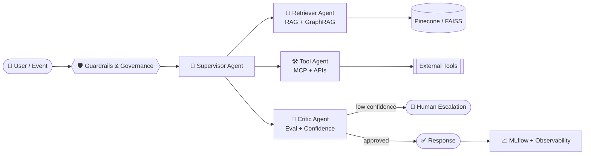
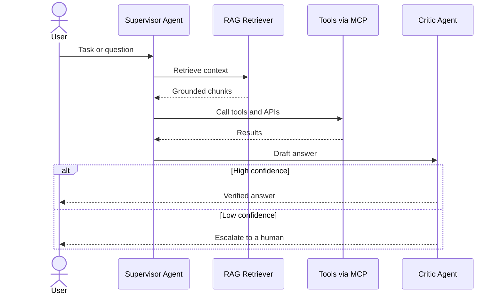
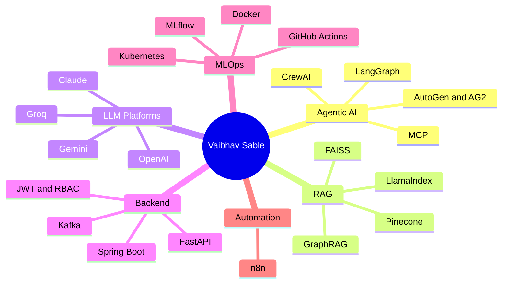
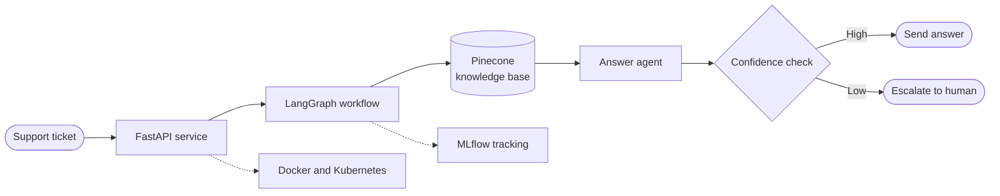
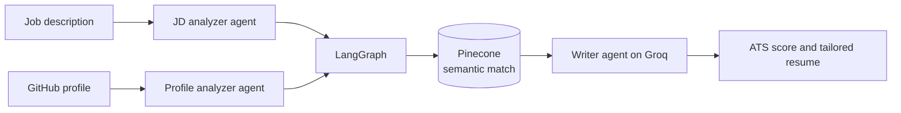
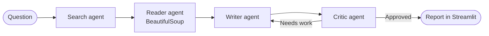
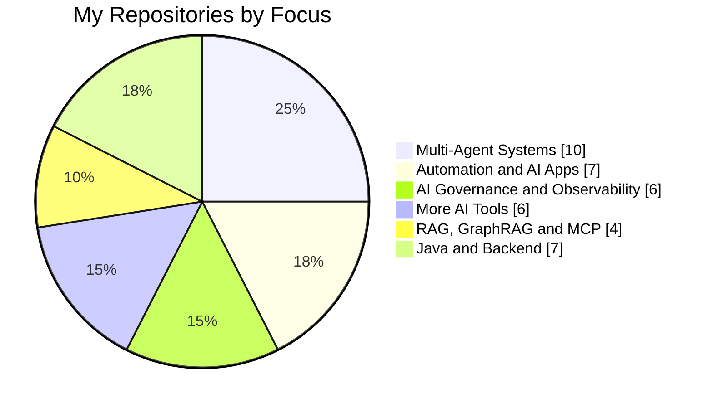
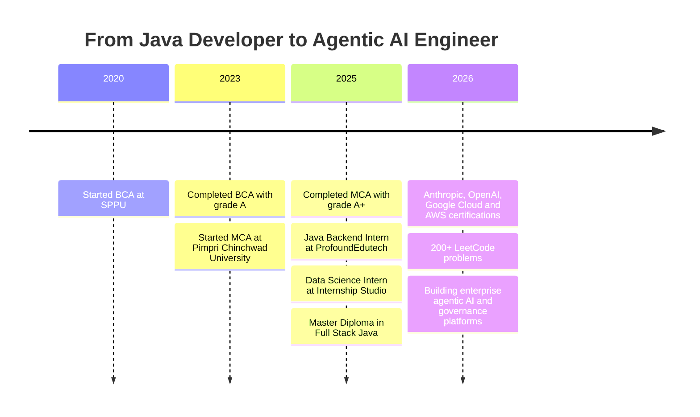
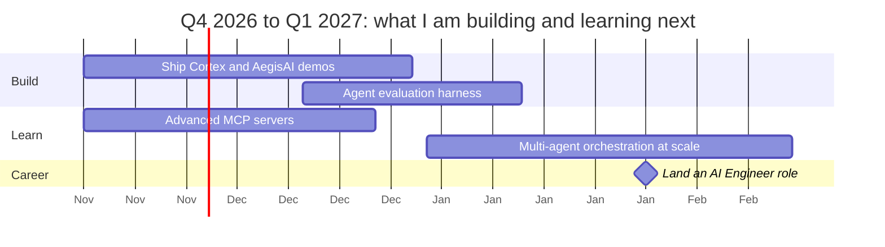

  

  

  
  
  
  

  
  
  
  
  

  <a href="#-tldr">⚡ TL;DR</a> ·
  <a href="#-impact">🍱 Impact</a> ·
  <a href="#-how-i-build">🧬 How I Build</a> ·
  <a href="#-projects">🏆 Projects</a> ·
  <a href="#-stack">🛠️ Stack</a> ·
  <a href="#-experience--education">💼 Experience</a> ·
  <a href="#-certifications">📜 Certs</a> ·
  <a href="#-roadmap">🛣️ Roadmap</a> ·
  <a href="#-contact">🤝 Contact</a>

> 💬 **30-second pitch:** I build multi-agent systems that retrieve, reason, act, and know when to hand off to a human. My projects combine **LangGraph, RAG, MCP and FastAPI** with governance and observability, shipped with **Docker, Kubernetes and MLflow**. I come from a Java microservices background, so reliability and security are part of the design from day one.

## ⚡ TL;DR

<table>
<tr>
<td width="50%" valign="top">

**🎯 Role** · AI Engineer
**🧠 Strength** · Multi-agent systems, RAG, MCP, AI governance
**🏗️ Ships** · FastAPI · vector search · LLM orchestration · Docker · MLflow
**💼 Experience** · Data Science Intern + Java Backend Intern
**🎓 Education** · MCA (A+) · BCA (A)

</td>
<td width="50%" valign="top">

**📜 Credentials** · 100+ (Anthropic, OpenAI, Google Cloud, AWS, Hugging Face, LangChain)
**🧩 Problem solving** · 200+ LeetCode · CodeChef · Codeforces
**📍 Based in** · Pune, India
**🌏 Open to** · Remote · Pune · Mumbai · Bengaluru · Hyderabad · Delhi NCR · Chennai
**⏱️ Availability** · Immediate joiner

</td>
</tr>
</table>

## 🍱 Impact

<table align="center">
<tr>
<td align="center" width="33%"><h1>56</h1><b>GitHub repositories</b> agents · RAG · governance · backend</td>
<td align="center" width="33%"><h1>100+</h1><b>Certifications</b> 13 from Anthropic alone</td>
<td align="center" width="33%"><h1>200+</h1><b>LeetCode problems</b> + CodeChef and Codeforces</td>
</tr>
<tr>
<td align="center"><h1>20+</h1><b>Secured REST APIs</b> JWT · RBAC · Docker</td>
<td align="center"><h1>+25%</h1><b>ETL efficiency</b> Data Science internship</td>
<td align="center"><h1>−35%</h1><b>Response time</b> AI chatbot integration</td>
</tr>
</table>

### 🎯 Why hire me

| | |
|---|---|
| 🧠 **Whole agent stack** | Supervisor agents, RAG retrieval, MCP tools, a critic, and a human-escalation path. |
| 🛡️ **Governance mindset** | AegisAI, NeuraGuard and ML-Sentinel focus on control, observability and safe deployment. |
| ⚙️ **Ships properly** | FastAPI, Docker, Kubernetes, MLflow and CI/CD, backed by real Java microservices experience. |
| 📚 **Learns fast** | 100+ certifications in 2025–26, newest on Claude, MCP, OpenAI and Google Cloud. |

### 🟢 Now

| | |
|---|---|
| 🔨 **Building** | Cortex Enterprise AI Platform · AegisAI Governance Agent · AI Customer Support Command Center |
| 📖 **Learning** | Advanced MCP servers · multi-agent orchestration · agent evaluation |
| 🎯 **Looking for** | AI Engineer role, immediate joiner |

### 🌐 Live demos

| Demo | Link |
|---|---|
| 💼 Portfolio | [portfolio-wheat-six-apdmu7v0c7.vercel.app](https://portfolio-wheat-six-apdmu7v0c7.vercel.app/) |
| 🤖 Multi-Agent Sales Support | [agentfd.netlify.app](https://agentfd.netlify.app) |
| 📄 Resume | [Open on Google Drive](https://drive.google.com/file/d/1lDAZOMSPLvNZG1pB7ps124SSN1N-UjTs/view?usp=sharing) |

## 🧬 How I Build

> **One idea behind every system: agents that retrieve, reason, act, and know when to escalate.**

<table>
<tr>
<td width="50%" valign="top">

#### 🧪 Design principles

| Principle | In practice |
|---|---|
| **Ground every answer** | Retrieve from a vector store before generating. |
| **Know when to stop** | Critic scores confidence; low scores go to a human. |
| **Split the work** | Supervisor routes to small specialist agents. |
| **Make it observable** | MLflow tracks quality and cost over time. |
| **Secure by default** | JWT + RBAC from my Java microservices work. |

</td>
<td width="50%" valign="top">

#### 🧰 Toolbox by use case

| When I need to... | I use |
|---|---|
| Stateful agent flows | LangGraph, LangChain |
| Role-based agent teams | CrewAI, AutoGen / AG2 |
| Connect agents to tools | MCP |
| Retrieve knowledge | Pinecone, FAISS, LlamaIndex, GraphRAG |
| Call LLMs | Groq, Claude, OpenAI, Gemini |
| Serve an API | FastAPI, Spring Boot |
| Quick automation | n8n |
| Track and ship | MLflow, Docker, K8s, GitHub Actions |

</td>
</tr>
</table>

<b>🔄 Sequence: how one agent handles a request</b>

<b>🧠 Skills mind map</b>

<b>🏗️ Architecture deep-dives (3 projects)</b>

**🛟 AI Customer Support Command Center**

**📄 ResumeForgeAI**

**🔎 Multi-Agent AI Research System**

## 🏆 Projects

### 📌 Featured

  
  
  
  
  
  

<b>🛡️ Enterprise AI Governance & Observability</b>

| Project | What it is |
|---|---|
| [**AegisAI – Governance Agentic RAG Platform**](https://github.com/Vaibhavsable451/AegisAI-Enterprise-AI-Governance-Agentic-RAG-Platform) | Enterprise AI governance with agentic RAG |
| [**AegisAI – Governance Agent**](https://github.com/Vaibhavsable451/AegisAI-Enterprise-AI-Governance-Agent) | Governance agent with a TypeScript front end |
| [**NeuraGuard**](https://github.com/Vaibhavsable451/NeuraGuard-Enterprise-Agentic-AI-Control-Governance-Platform) | Control and governance layer for agentic AI |
| [**ML Governance & AI Observability Platform**](https://github.com/Vaibhavsable451/-ML-Governance-AI-Observability-Platform) | Governance and observability for ML systems |
| [**ML-Sentinel**](https://github.com/Vaibhavsable451/ML-Sentinel-Autonomous-ML-Intelligence-Platform) | Autonomous ML intelligence platform |
| [**NeuroForge AI**](https://github.com/Vaibhavsable451/-NeuroForge-AI-Adaptive-Multimodal-Agent-Intelligence-Platform) | Adaptive multimodal agent intelligence platform |
| [**Cortex Enterprise AI Platform**](https://github.com/Vaibhavsable451/Cortex-Enterprise-AI-Platform) | Enterprise AI platform |

<b>🧠 RAG · GraphRAG · MCP</b>

| Project | Stack |
|---|---|
| [**RAG-Assistant – Enterprise RAG with LangChain + MCP**](https://github.com/Vaibhavsable451/RAG-Assistant-Enterprise-RAG-with-LangChain-MCP) | LangChain, MCP, RAG |
| [**GraphRAG Agentic Multilingual RAG**](https://github.com/Vaibhavsable451/graphrag-agentic-multilingual-rag) | GraphRAG, agents, multilingual |
| [**Q&A AI Agent with RAG (n8n)**](https://github.com/Vaibhavsable451/Q-A-AI-Agent-with-RAG-using-n8n-) | n8n, RAG, Pinecone |
| [**AI Data Science LLM Studio**](https://github.com/Vaibhavsable451/AI-Data-Science-LLM-Studio) | LLMs, Jupyter |

<b>🤖 Multi-Agent Systems</b>

| Project | Stack | Highlights |
|---|---|---|
| [**AI-Customer-Support-Command-Center**](https://github.com/Vaibhavsable451/AI-Customer-Support-Command-Center) | LangGraph, RAG, Pinecone, FastAPI, MLflow, Docker, K8s | Confidence-based escalation |
| [**TalentFlow AI**](https://github.com/Vaibhavsable451/TalentFlow-AI-Multi-Agent-Recruitment-Automation-System) | Multi-agent | Recruitment automation |
| [**ResumeForgeAI**](https://github.com/Vaibhavsable451/ResumeForgeAI-Multi-Agent-ATS-Resume-Builder-) | LangGraph, Pinecone, Groq, FastAPI | Analyzes JDs + GitHub profiles |
| [**Agentic ATS Resume Generator**](https://github.com/Vaibhavsable451/Agentic-ATS-Resume-Generator) | Python, LangGraph, Pinecone, Groq | ATS scoring, semantic + keyword matching |
| [**Resume Intelligence ATS Optimizer**](https://github.com/Vaibhavsable451/Resume-Intelligence-ATS-Optimizer) | JavaScript | ATS optimization |
| [**Multi-Agent AI Research System**](https://github.com/Vaibhavsable451/Multi-Agent-AI-Research-System) | LangChain, Groq, Streamlit | Search → Reader → Writer → Critic |
| [**multi_agent_sales_support**](https://github.com/Vaibhavsable451/multi_agent_sales_support) | n8n, Groq | Supervisor routing · [Live Demo](https://agentfd.netlify.app) |
| [**Cricket Multi-Agent Factory**](https://github.com/Vaibhavsable451/Cricket-Multi-Agent-Factory-Supervisor-6-Agents---Groq-v2) | n8n, Groq, SerpAPI | 6 specialist agents |
| [**AI Sales Intelligence Agent**](https://github.com/Vaibhavsable451/AI-Sales-Intelligence-Agent) | n8n, Groq, SerpAPI | Website analysis + pain-point detection |
| [**YouTube Summarizer Multi-Agent**](https://github.com/Vaibhavsable451/Agentic-AI-YouTube-Summarizer-Multi-Agent-System-) | LangChain, Groq | 4-agent pipeline |

<b>⚙️ Automation & AI Apps</b>

| Project | Stack |
|---|---|
| [**ai-content-repurpose-agent**](https://github.com/Vaibhavsable451/ai-content-repurpose-agent) | Python |
| [**AI Cold Email Outreach & Follow-Up**](https://github.com/Vaibhavsable451/AI-Cold-Email-Outreach-Follow-Up-Automation-n8n) | n8n |
| [**company-news-meeting-automation**](https://github.com/Vaibhavsable451/company-news-meeting-automation) | n8n |
| [**FinPassbookAI**](https://github.com/Vaibhavsable451/FinPassbookAI) | HTML, AI |
| [**Ai-Code-Editor**](https://github.com/Vaibhavsable451/Ai-Code-Editor) | JavaScript |
| [**Ai Personal Assistant JARVIS**](https://github.com/Vaibhavsable451/Ai-Peronal-Assitant-JArvis) | HTML, JS (voice) |
| [**ecommerce-website-with-n8n-ai-chatbot**](https://github.com/Vaibhavsable451/ecommerce-website-with-n8n-ai-chatbot) | HTML, n8n |

<b>🧰 More AI Tools</b>

| Project | Stack |
|---|---|
| [**Job-Finder-AI-Agent**](https://github.com/Vaibhavsable451/Job-Finder-AI-Agent) | Python, Groq |
| [**Job-Mail-AI-Tracker**](https://github.com/Vaibhavsable451/Job-Mail-AI-Tracker) | Python |
| [**Resume-Anlayzer**](https://github.com/Vaibhavsable451/Resume-Anlayzer) | Python |
| [**Advanced Real-Time AI Personal Assistant**](https://github.com/Vaibhavsable451/Advanced-Real-Time-AI-Personal-Assistant) | Python |
| [**ai-house-price-prediction**](https://github.com/Vaibhavsable451/ai-house-price-prediction) | Jupyter, ML |
| [**3D Portfolio Website**](https://github.com/Vaibhavsable451/3d-Portfolio-Website) | HTML, Three.js |

<b>☕ Backend, Microservices & Full-Stack (Java)</b>

| Project | Stack |
|---|---|
| [**AI-Powered Fitness App (Spring Boot Microservices)**](https://github.com/Vaibhavsable451/AI-Powered-Fitness-App-With-Spring-Boot-Microservices) | Java, Spring Boot, microservices, AI |
| [**Employee-Management-System**](https://github.com/Vaibhavsable451/Employee-Management-System) | Java, Spring Boot, MySQL |
| [**MazeBank**](https://github.com/Vaibhavsable451/MazeBank) | Java |
| [**JPMorgan Forage Simulation**](https://github.com/Vaibhavsable451/jpmorgan-forage-simulation) | Java |
| [**Spring AI – Generative AI App**](https://github.com/Vaibhavsable451/Spring-AI-Build-Generative-AI-application-) | Java, Spring AI |
| [**Tech Release Email Agent**](https://github.com/Vaibhavsable451/Tech-Release-Email-Agent-Java-React-Groq-AI-n8n-) | Java, React, Groq, n8n |
| [**Ecommerce_multivendor**](https://github.com/Vaibhavsable451/Ecommerce_multivendor) | TypeScript, React |

📌 **[Explore all 56 repositories →](https://github.com/Vaibhavsable451?tab=repositories)**

## 🛠️ Stack

| Layer | Tools |
|---|---|
| 🤖 **Agents & orchestration** |       |
| 🧠 **LLMs** |      |
| 🔎 **Retrieval** |    |
| 📈 **ML & MLOps** |    |
| 🔐 **Backend & security** |     |

## 💼 Experience & Education

| Role | Company | Period | Impact |
|---|---|---|---|
| **Data Science Intern** | Internship Studio | Jun 2025 – Dec 2025 | ETL pipelines (**+25% efficiency**), automated reporting, ML-driven stakeholder insights |
| **Java Backend Developer Intern** | ProfoundEdutech Pvt. Ltd. | Feb 2025 – Sep 2025 | **20+ REST APIs**, JWT/RBAC security, Dockerized deployment, AI chatbot integration (**−35% response time**) |

| Degree | Institution | Period | Grade |
|---|---|---|---|
| **MCA — Computer Science** | Pimpri Chinchwad University, Pune | Aug 2023 – May 2025 | **A+** |
| **BCA — Computer Applications** | Savitribai Phule Pune University | Jan 2020 – May 2023 | **A** |

**MCA final-year project:** a production-style **microservices e-commerce backend** with Spring Boot, Apache Kafka, Docker and MySQL: Eureka service discovery, API Gateway, JWT authentication, event-driven architecture, and 20+ secured REST APIs with role-based access control.
**Coursework:** Distributed Systems · DBMS · Cloud Computing · Software Engineering · DSA · Object-Oriented Design

### 🧩 Competitive programming

  
  
  

## 📜 Certifications

  
  
  
  
  

### ⭐ Highlights (AI Engineering)

| Issuer | Credential | Issued |
|---|---|---|
| **Anthropic** | Claude Academy: Claude with Amazon Bedrock | Sep 2026 |
| **OpenAI Academy** | AI Leadership · Agents and Workflows · Applied AI Foundations · AI Foundations | Aug–Sep 2026 |
| **Google Cloud** | Gen AI Academy APAC Edition (Cohort 2) — MCP | Jul 2026 |
| **LangChain Playground** | Deep Agents | Mar 2026 |
| **Hugging Face** | AI Agents Fundamentals (smolagents) | Mar 2026 |
| **Activeloop** | Gen AI 360 — RAG with LangChain & LlamaIndex | Mar 2026 |
| **AWS** | Introduction to Agentic AI on AWS · Foundations of Prompt Engineering | Mar 2026 |
| **Analytics Vidhya** | CrewAI, AutoGen, AG2, Deep Research Agent, Data Analyst Agent, Knowledge Bases & Memory, Agentic AI with Bedrock | Mar 2026 |
| **LinkedIn** | RAG Fine-Tuning · Introduction to Spring AI · MCP Advanced Topics | Apr 2026 |
| **LinkedIn Learning** | Claude Agent SDK · OpenAI AgentKit · Reasoning Models for AI Agents · GPT-5 Agents · MCP for Beginners (Microsoft) · Cursor 2 Agents | Jan–Mar 2026 |

<b>🤖 Anthropic</b>

- Claude with Amazon Bedrock *(Feb 2026 and Sep 2026)*
- Claude with Google Cloud's Vertex AI
- Building with the Claude API
- Introduction to Model Context Protocol
- Model Context Protocol: Advanced Topics
- Claude Code in Action
- Claude 101
- AI Fluency: Framework & Foundations
- AI Fluency for Educators · Students · Nonprofits
- Teaching AI Fluency

<b>☁️ Cloud, DevOps & Data</b>

- AWS AI Practitioner Challenge · AWS AI & ML Scholars 2026 · AWS Productivity App Badge (Udacity)
- AWS Fundamentals (Coursera)
- Kubernetes: Advanced Deployment Strategies · Securing, Monitoring & Scaling · Integration & Orchestration (Coursera / LearnQuest)
- Cloud Native, Microservices, Containers, DevOps and Agile (Coursera)
- Apache Kafka (Coursera)
- CI/CD for Beginners · Practical GitHub Actions · Career Essentials in GitHub
- IBM Data Science (Coursera) · Power BI Capstone (Coursera)

<b>✨ Prompt Engineering, Automation & Productivity</b>

- Automate Everything With n8n (LetsUpgrade) · Build Custom Chatbots with n8n
- Prompt Engineering for Everyone (Cognitive Class) · Advanced Prompt Engineering (upGrad, LinkedIn Learning)
- AI Agents for Beginners (Simplilearn) · Understanding Agentic AI
- Generative AI Mastermind (Outskill) · Vibe Coding Your First Agent with Google Gemini
- Gemini Certified Student (Google, valid to Nov 2028)
- HP LIFE: AI for Beginners, AI for Business Professionals, Critical Thinking in the AI Era, Agile Project Management and more

<b>☕ Software Engineering & Full-Stack</b>

- HackerRank: Software Engineer · SQL (Advanced) · Java (Basic) · JavaScript (Intermediate) · Frontend Developer (React) · Software Engineer Intern
- Full Stack Java Developer — Master Diploma, ProfoundEdutech (Grade A+)
- Java Unit Testing with JUnit & Mockito · Getting Started with Full Stack Java
- Meta Front-End Developer · Meta Back-End Developer (Coursera)
- MERN Stack · MEAN Stack (Coursera)
- Software Architecture & System Design Foundations
- Forage Job Simulations: JPMorgan Chase · Walmart · PepsiCo · Accenture · Quantium · Cisco · Blackbird

## 📊 GitHub Analytics

  <picture>
    <source media="(prefers-color-scheme: dark)" srcset="https://github-readme-stats.vercel.app/api?username=Vaibhavsable451&show_icons=true&theme=tokyonight&hide_border=true&include_all_commits=true&count_private=true&border_radius=12">
    <source media="(prefers-color-scheme: light)" srcset="https://github-readme-stats.vercel.app/api?username=Vaibhavsable451&show_icons=true&theme=default&hide_border=true&include_all_commits=true&count_private=true&border_radius=12">
    
  </picture>
  

  <picture>
    <source media="(prefers-color-scheme: dark)" srcset="https://streak-stats.demolab.com/?user=Vaibhavsable451&theme=tokyonight&hide_border=true">
    <source media="(prefers-color-scheme: light)" srcset="https://streak-stats.demolab.com/?user=Vaibhavsable451&theme=default&hide_border=true">
    
  </picture>

  

  

  

## 🛣️ Roadmap

*Updated November 2026.*

🌱 **Exploring:** MCP · multi-agent orchestration · agent evals · AI governance · GraphRAG

## ❓ Ask Me About

<b>How do you make agents reliable?</b>

Confidence-based escalation. A critic agent scores each answer, and low-confidence cases go to a human instead of guessing. See [AI-Customer-Support-Command-Center](https://github.com/Vaibhavsable451/AI-Customer-Support-Command-Center).

<b>How do you reduce hallucinations in RAG?</b>

Grounded retrieval with vector search (Pinecone, FAISS), semantic plus keyword matching, and GraphRAG for multi-hop questions. See [graphrag-agentic-multilingual-rag](https://github.com/Vaibhavsable451/graphrag-agentic-multilingual-rag).

<b>Which agent frameworks do you use?</b>

LangGraph and LangChain for stateful flows, CrewAI and AutoGen/AG2 for role-based teams, and n8n for fast automation. Tools connect through MCP.

<b>Can you take a model to production?</b>

Yes. FastAPI services, Docker and Kubernetes, MLflow tracking, and CI/CD with GitHub Actions. My Java backend work adds JWT/RBAC security and microservices experience.

<b>When can you join?</b>

Immediately. Open to remote roles, or on-site and hybrid in Pune, Mumbai, Bengaluru, Hyderabad, Delhi NCR and Chennai.

## 🤝 Contact

  <b>Hiring for an AI / GenAI / Agentic AI role? Let's talk.</b>  
  
  

<table align="center">
<tr>
<td align="center"><b>Portfolio</b> </td>
<td align="center"><b>LinkedIn</b> </td>
</tr>
</table>

  
  

<a href="#top">⬆️ Back to top</a>

<i>⚡ Building production-ready Agentic AI systems, one agent at a time.</i>

  

